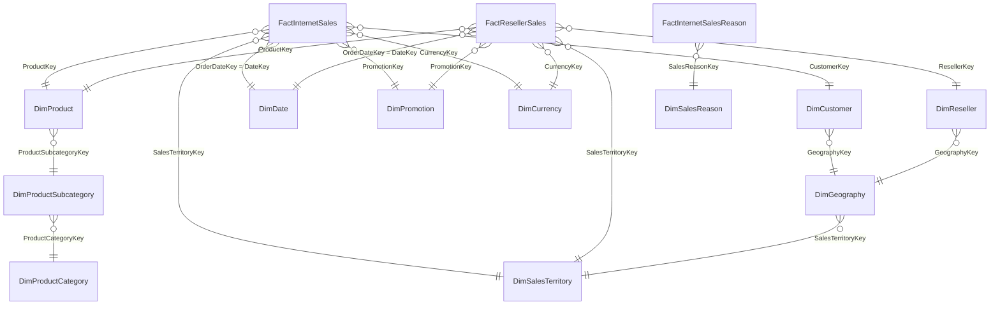

# Data: the AdventureWorks sales warehouse

The assistant runs on **AdventureWorks DW**, Microsoft's sample data warehouse for a fictional
bicycle manufacturer. It is public and MIT licensed, so every question, report and demo can be
shown without any private or client data.

## Why this dataset

* **Multi-year:** orders from 29 Dec 2010 to 28 Jan 2014 (internet) and 29 Nov 2013 (reseller).
* **Joined, interdependent tables:** a star schema, the shape of a real sales warehouse.
* **Two sales channels:** internet sales to customers, and reseller sales to shops.
* **Territories as tenants:** ten sales territories in three groups, used for row-level security
  (a Northwest manager sees only Northwest).
* **Product descriptions:** real text for the document side of the chatbot.

## Star schema, in one line

*Fact* tables hold events (one row per sales line). *Dimension* tables describe them (product,
customer, territory, date). Facts point to dimensions by keys.

## Tables

| Table | Rows | What one row is |
|---|---:|---|
| FactInternetSales | 60,398 | one line of an online order |
| FactResellerSales | 60,855 | one line of an order from a reseller shop |
| FactInternetSalesReason | 64,515 | a reason a customer gave for an online order line |
| DimProduct | 606 | a product (e.g. "Mountain-200 Black, 38") with its price and description |
| DimProductSubcategory | 37 | e.g. Mountain Bikes, Helmets |
| DimProductCategory | 4 | Bikes, Components, Clothing, Accessories |
| DimCustomer | 18,484 | an online customer (no personal data loaded: see below) |
| DimReseller | 701 | a reseller shop |
| DimGeography | 655 | a city, state and country |
| DimSalesTerritory | 11 | Northwest, Northeast, Central, Southwest, Southeast, Canada, France, Germany, United Kingdom, Australia (plus "NA") |
| DimDate | 3,652 | a calendar day with month, quarter and fiscal year |
| DimPromotion | 16 | a discount campaign |
| DimCurrency | 105 | a currency |
| DimSalesReason | 10 | e.g. Price, Quality, Promotion |

## How it is loaded: four enterprise habits

The loader is [`samples/load_adventureworks.py`](../../samples/load_adventureworks.py).

1. **Pinned source (lineage).** Files come from `github.com/microsoft/sql-server-samples` at commit
   `b47eadc85277f72843647223cde53aa1b85ffcb8`, so everyone builds the same data.
2. **Checksums.** Every file's sha256 is checked before loading; a changed file is refused.
3. **Data minimisation.** Customer names, e-mail addresses, phone numbers, street addresses and
   birth dates are **not loaded**. The assistant cannot leak data the warehouse view never held.
   Product photos and non-English text columns are also dropped.
4. **Integrity.** Foreign keys are declared and checked (`PRAGMA foreign_key_check`) after the
   load; the schema graph finds all 18 join paths from them.

## Licence

AdventureWorks sample data: MIT License, "Microsoft SQL Server Sample Code", Copyright (c)
Microsoft Corporation.
