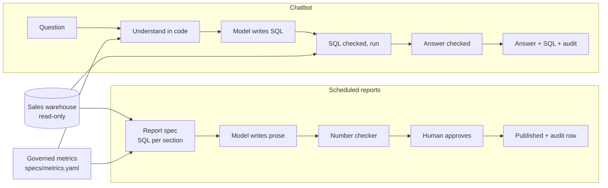

# 1. The problem and the big picture

## Why not just ask a chatbot for the report?

Try it. Paste last month's sales table into a chatbot and ask for a summary. You will get a
good-looking paragraph. Now check every number in it against the table. Often one or two
are wrong: a total that is slightly off, a percentage it worked out itself, a month that
belongs to another row.

This is not a bug that a better prompt removes. An LLM predicts likely text. A likely number
is not the same as the correct number. Newer models make fewer mistakes, but "fewer" is not
"none", and nobody can tell which sentence is the wrong one without checking all of them.

So the design question is not "which model writes the best report?" It is:

> How do we use a model for what it is good at (words) and keep it away from what it is
> bad at (being the source of numbers)?

## The split: who does what

| Job | Done by | Why |
|---|---|---|
| Decide what a business number means | People, in a reviewed file | It is a business decision, not a guess |
| Compute the numbers | The database, with SQL | Databases do arithmetic exactly |
| Write the sentences | The model | Fluent, fast, cheap |
| Check every number in the sentences | Plain code (no AI) | It must give the same answer every time |
| Decide if a report goes out | A person | Accountability |
| Record what happened | An audit log | So anyone can check later |

The model is one worker in a line, and it never has the last word.

## Two capabilities, one warehouse

**Scheduled reports** run on a timetable: a monthly business review, a weekly operations
report. A person reviewed each query once, so every run is the same computation.

**The chatbot** answers questions nobody planned for. Here the model must write the query,
which is riskier, so more of the work moves into code: understanding the question, checking
the query, checking the answer.

Both share the same warehouse, the same metric definitions, the same number checker and the
same audit idea. That is deliberate. In an enterprise, a report and a chatbot that disagree
about "revenue" destroy trust in both.

## Why "agentic", and how much freedom the model gets

An **agent** is software where a model decides the next step, often by calling tools. More
freedom means more things it can do, and more ways it can go wrong.

This system gives the model very little freedom, on purpose:

* In reports, the steps are fixed (a **workflow**). The model only writes prose.
* In the chatbot, code decides what the question means. The model writes one SQL query, which
  code then checks.

This is called **bounded autonomy**: the model acts only inside limits that code enforces. For
numbers that people make decisions on, that is the right amount. If an interviewer asks "is
this really agentic?", the honest answer is "it is an agentic workflow with bounded autonomy,
because freedom over numbers is the risk."

## The cost of getting it wrong, and of getting it right

* Wrong: one invented number in a board pack. The cost is trust, and it is hard to win back.
* Right: each report costs about $0.0006 and each chatbot answer about $0.00024 in model fees
  (measured, chapter 7). Checking in code costs nothing extra.

The checks are cheap. Skipping them is the expensive choice.

## What you will see in the rest of the guide

The same pattern repeats in every chapter:

1. **Decide in code** whatever can be decided in code.
2. **Give the model the smallest job** that still needs a model.
3. **Check the model's output** with code before anyone sees it.
4. **When unsure, ask a person**, or refuse, but never guess.
5. **Record everything**, so a mistake can be traced.

Next: [2. The data](02-data.md)
