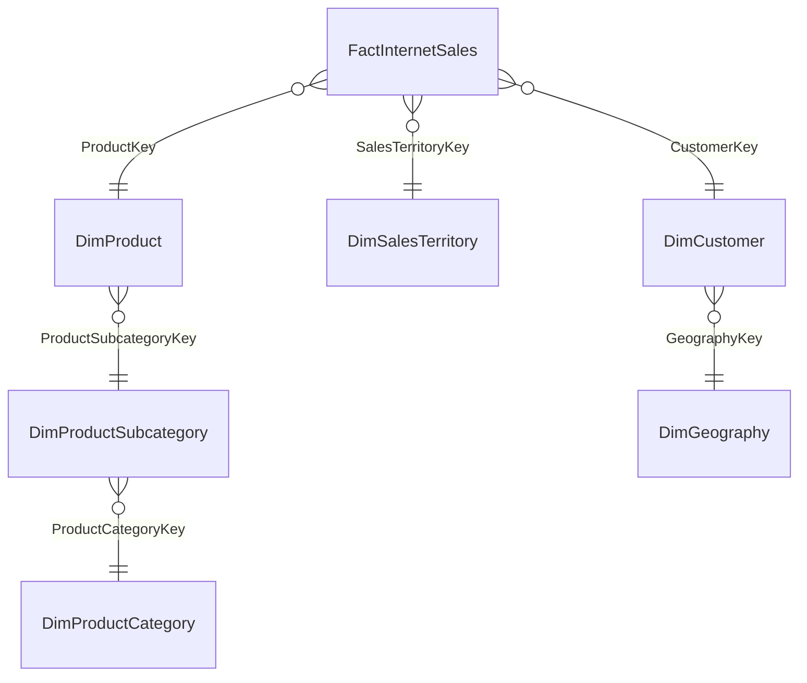

# 2. The data

## What a data warehouse is

A **data warehouse** is a database built for questions, not for running the business. The
shop's checkout system writes one sale at a time. The warehouse gets a copy of those sales,
reorganised so that questions like "sales by region by month" are easy and fast.

## The star schema: facts and dimensions

Most warehouses use a **star schema**. It has two kinds of table:

* **Fact tables** hold events, one row per event. Here: one row per sales order line, with the
  amount, the quantity and the date.
* **Dimension tables** describe the things in an event: the product, the customer, the sales
  territory, the promotion.

A fact row points to its dimensions with **keys** (numbers like `ProductKey = 358`). Drawn on
paper, the fact table sits in the middle and the dimensions around it, like a star.

Read `}o--||` as "many rows here point to one row there". Many sales lines point to one
product. That direction matters a lot in chapter 6.

## Our sample: AdventureWorks

**AdventureWorks DW** is Microsoft's public sample warehouse for a bicycle company (MIT
licence). We load 14 tables from it into `samples/adventureworks.sqlite`:

* two fact tables: internet sales (60,398 lines) and reseller sales (60,855 lines);
* dimensions for products (606), product subcategories and categories, customers, geography,
  sales territories, resellers, promotions, dates and sales reasons.

Internet orders run from 29 Dec 2010 to 28 Jan 2014; reseller orders end on 29 Nov 2013.
Those end dates matter: chapter 6 shows why "last month" must be counted from them.

**Why a public sample, not company data.** This is a public repository. Real company data
must never be in it. A public sample also lets anyone reproduce every number in this guide.
The repo also has two small synthetic databases (`samples/sales.sqlite`, `samples/ops.sqlite`)
generated by seeded scripts, for fast tests.

## Decision: load demo data the way production data is loaded

**The simple way.** Download a CSV from the internet and import it.

**What goes wrong.** Next month someone downloads it again and gets a changed file. Your
numbers change and nobody knows why. Or the file was tampered with. Or it holds personal data
you did not need and now must protect.

**What we do.** `samples/load_adventureworks.py` follows four habits:

1. **Pinned source.** Files come from one fixed Git commit, never "latest". Everyone gets the
   same data. This is **data lineage**: you can say exactly where a number came from.
2. **Checksums.** Each file's SHA-256 fingerprint is checked before loading. A changed or
   tampered file is refused. This is a small **supply-chain** control.
3. **Data minimisation.** Customer names, e-mails, phones, addresses and birth dates are not
   loaded at all. The AI layer cannot leak what it never had. India's DPDP Act and Europe's
   GDPR both expect this.
4. **Keys declared and checked.** Foreign keys are declared and SQLite's
   `foreign_key_check` must pass. A broken link between tables fails the load.

**In an enterprise.** The same four habits, with bigger tools: a data catalogue for lineage,
signed or checksummed ingestion, a "curated" or "gold" layer that drops personal data before
analytics, and data-quality tests (for example dbt tests or Great Expectations) on every load.

**Where.** `samples/load_adventureworks.py`, `docs/data/README.md`.

**Proof.** The CI job `chat-eval` downloads the files, checks every checksum, and loads them
on every push.

## Decision: the AI layer reads, never writes

**The simple way.** Give the app a normal database login.

**What goes wrong.** A bug, or a malicious instruction hidden in a question, runs `DELETE`.

**What we do.** Every query goes through four independent locks (chapter 9 has the detail):
a SQL text check, a read-only connection, a read-only setting, and a per-query allow-list of
tables. Any one of them is enough to stop a write. All four must fail together for harm.

**In an enterprise.** A database role with `SELECT` only, on a read replica, with row-level
security so each user sees only their region (chapter 10).

## Decision: the map of the warehouse is separate from its rows

Chapter 6 builds a **schema graph**: a map of tables, columns, keys and metrics. It is built
from the database's own description of itself (its metadata), not from the rows. A model that
needs to write SQL sees a small part of the map, never the whole table of customers.

Next: [3. Governed metrics and specs as code](03-metrics-and-specs.md)
