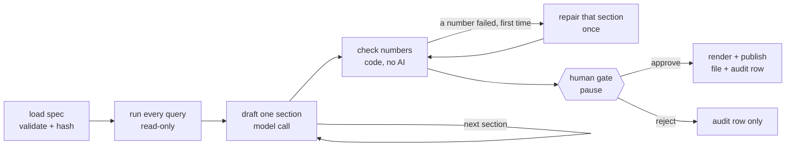

# 4. Scheduled reports

A report run takes a spec (chapter 3), runs its queries, has the model write each section,
checks every number, waits for a person, then publishes and records the decision.



The steps are wired as a **LangGraph** graph (`agentic_reporting/graph.py`). LangGraph is a
library for workflows that call models. Each box is a **node**; the arrows are **edges**.

## Step by step

1. **load**: validate the spec, compute its version (SHA-256), fix the report's timestamp.
2. **query_all**: run each section's SQL through the read-only path. Each result becomes a
   table of **facts**, keyed by column and row: `revenue[0] = 111850.2`.
3. **draft**: one model call per section. The model sees only that section's rows and facts.
4. **check**: code verifies every number in the text against that section's facts (chapter 5).
5. **repair**: a failing section is redrafted once, with the rejected numbers named.
6. **gate**: the run pauses for a person.
7. **render / publish**: write the report file and one audit row. **reject** writes only the row.

## Decision: the model returns structured output, not loose text

**The simple way.** Ask for a paragraph and use whatever comes back.

**What goes wrong.** You cannot tell which number the model meant to take from where. Parsing
free text for that is guesswork.

**What we do.** The model must reply in a fixed JSON shape, the same for every section:

```json
{"text": "Revenue was 111,850.2, down 9.8% on the prior month.",
 "numbers_used": [{"value": 111850.2, "fact_key": "revenue[0]"},
                  {"value": -9.8, "fact_key": "change_pct[0]"}]}
```

`numbers_used` is the model's own citation list: every number it wrote, and the fact it came
from. The checker does not trust it (it checks the text itself), but a citation that does not
match its fact is a failure too. The format is fixed for every report and every section; only
the facts change.

**How it is enforced.** The JSON shape is a Pydantic **schema**. It is sent to the model as a
**tool** definition, and the model is forced to "call" that tool, which makes it return valid
JSON. If a model cannot do that, the schema goes in the prompt and the reply is validated, with
one repair round-trip. (Chapter 7.)

**Where.** `agentic_reporting/draft.py`, `providers/converse_provider.py`.

## Decision: one section per step, saved after each step

**The simple way.** Draft all sections in one long call or one loop in memory.

**What goes wrong.** The process crashes on section 4 (a network error, a pod restart).
Everything is lost, and the retry pays for sections 1 to 3 again.

**What we do.** Each section is its own step, and LangGraph saves the state after every step
to a **checkpoint** (a SQLite file, written synchronously). A crashed run resumes with
`--resume` at the section that failed. A model call that errors (a timeout, a server error)
is tried up to three times by a retry policy before the step gives up.

**In an enterprise.** The checkpoint store is Postgres (LangGraph has a Postgres saver), so any
worker can resume any run.

**Proof.** `tests/test_cli.py::test_crash_then_resume_completes_without_redrafting`.

## Decision: repair once, then mark, never loop

**The simple way.** If a number fails, ask the model again until it passes.

**What goes wrong.** Some models never fix it. The loop burns money, or the run never ends.

**What we do.** One repair call per failing section, naming the rejected numbers. If it still
fails, the section goes to the person with the problem shown. If published anyway, each
unsupported number is replaced with `[unverified]`, visibly.

## Decision: a person approves every publish

**The simple way.** Publish automatically once the checks pass.

**What goes wrong.** The checker proves numbers came from the data. It cannot prove the
sentence is fair, the query was the right one, or that this report should go out today.
Those are judgement calls. In a regulated company, someone must own them.

**What we do.** The graph stops at a LangGraph `interrupt()`. The person sees a preview, any
unsupported numbers and any "this number's row or column is not named in its sentence"
warnings. They approve or reject, from another process or another day:

```
python -m agentic_reporting.run --resume --thread <thread> --decision approve
```

This is **human-in-the-loop**. A `--no-gate` switch exists for tests and CI only.

**Honest gap.** Today the approver's name is self-declared (`REPORT_APPROVER`). In an
enterprise the approval comes through single sign-on, and only a role such as
`report-approver` may approve. That is designed (chapter 10), not built.

**Proof.** `tests/test_graph.py` (pause; approve writes a file and one row; reject writes no file).

## Decision: every decision leaves an audit row

Each publish or reject writes one row: the report, the spec version, the model, the cost, the
number of model calls, how many numbers were checked, how many were unverified, who decided,
and when. The run's ID is the row's key and the insert ignores duplicates, so a step replayed
after a crash cannot write a second row.

**In an enterprise.** An append-only table that the application cannot update or delete
(database permissions), or a ledger database, shipped to the central log store.

**Where.** `agentic_reporting/audit.py`.

## Decision: a budget the run cannot exceed

`--max-usd` and `--max-llm-calls` cap a run. The budget is checked before every model call.
When it runs out, the remaining sections are marked "not drafted" and the run still goes to
the person, who sees exactly what was skipped. That is bounded autonomy for money.

**Where.** `agentic_reporting/budget.py`. **Proof.**
`tests/test_graph.py::test_budget_stops_drafting_and_says_so`.

Next: [5. The number checker](05-the-number-checker.md)
