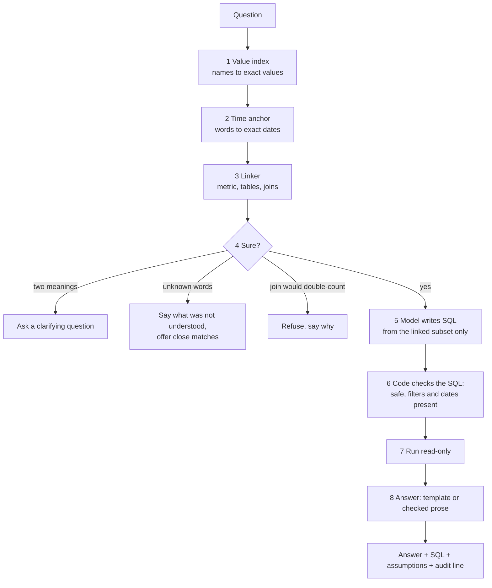

# 6. The chatbot

## The job

A sales manager types:

> What were internet sales of Mountain-200 Black, 38 in the Northwest in 2013?

The bot must find the right number, show how it got it, and never make one up. The usual
approach, **text-to-SQL**, gives the question and the database schema to a model and asks for
a SQL query. Benchmarks show models write valid SQL most of the time. The danger is not
broken SQL. It is SQL that runs and returns a wrong number.

## Five quiet ways text-to-SQL goes wrong

None of these is a syntax error. Each returns a confident answer.

| # | Failure | Example |
|---|---|---|
| 1 | A value spelled wrong | `Region = 'North West'`: zero rows, so "sales were 0" |
| 2 | A word dropped | "Atlas Laptop" is ignored, so it answers total sales |
| 3 | The wrong dates | "last 10 days" counted from today, on data that ends in 2014 |
| 4 | A word with two meanings | "sales": internet or reseller? |
| 5 | A join that double-counts | internet sales "by reseller" repeats rows and inflates the sum |

The design answer to all five is the same: **decide in code everything that can be decided in
code, before the model is called.**

## The pipeline

Steps 1 to 4 have no AI in them. Only step 5 calls a model, and steps 6 to 8 check its work.

## Step 1. The value index: names become exact values

**The simple way.** Let the model guess how "Northwest" is spelled in the data.

**What goes wrong.** Failure 1: `'North West'`, zero rows, a confident "0".

**What we do.** `values.py` reads the distinct values of a short list of columns (product
names, models, colours, categories, territories, states, resellers, promotions) and builds a
lookup. Words in the question are matched against it:

* "Mountain-200 Black, 38" → `DimProduct.EnglishProductName = 'Mountain-200 Black, 38'`
* "Northwest" → `DimSalesTerritory.SalesTerritoryRegion = 'Northwest'`

**Longest match wins.** "Mountain-200 Black, 38" also contains the model "Mountain-200" and the
colour "Black". The longest match covers the shorter ones. But "Mountain-200 Black" (no size)
becomes two filters, model and colour, which is exactly right: all sizes.

**Ties are shown, not hidden.** "Canada" is both a territory region and a country. The column
listed first wins, and the answer says "also a sales territory country" as an assumption.

**Governance.** Only columns listed in `specs/entities.yaml` are ever read. Measures, keys and
customer columns are not. That list is the boundary of what the AI layer can see.

This lookup, plus the product → subcategory → category links it records, is the start of the
**knowledge graph**: business things and how they relate.

## Step 2. The time anchor: words become exact dates

**What goes wrong.** Failure 3. Today is 2026. The data ends on 28 January 2014. "Last 10 days"
from today returns nothing.

**What we do.** `timeframe.py` finds the last date in the metric's data (the **anchor**) and
turns time words into exact dates, by fixed rules:

| Words | Becomes (internet sales, anchor 2014-01-28) |
|---|---|
| last 10 days | 2014-01-19 to 2014-01-28 |
| last month | 2014-01-01 to 2014-01-28 (and "January 2014 is a partial month") |
| previous month | 2013-12-01 to 2013-12-31 |
| Q3 2013 | 2013-07-01 to 2013-09-30 |
| 2013 | 2013-01-01 to 2013-12-31 |

Reseller data ends on 29 Nov 2013, so its "last quarter" is different. The anchor is per metric.

**Why in code?** Date arithmetic is a classic place for models to slip by one day or pick the
wrong quarter. Rules in code are tested once and right forever.

## Step 3. The linker: which metric, which tables, which joins

`schema_graph.py` matches the question's words to the governed metrics (chapter 3), tables and
columns, then finds how to join the tables.

**Decision: joins go one way only.** A sale points to one product, one territory (many-to-one).
The linker only follows joins in that direction: from the fact to its dimensions, and on to
their parents. Going the other way, from a dimension back to a second fact table, repeats rows:
every internet sale would be counted once per reseller in the same state. That is a **fan
trap**, failure 5. Such a question is refused with the reason, not answered with a big number.

## Step 4. Ask, refuse, or go on

* **Two meanings** (failure 4): "sales" alone → "This warehouse has two sales channels. Which
  sales do you mean?" with the options. The person picks; the answer names the definition used.
* **Unknown words** (failure 2): "Atlas Laptop" → "I could not match 'Atlas Laptop' (nothing
  similar in this data), 'North' (closest: Northwest; Northeast...)". It will not guess, because
  a word it ignores is a filter it drops.
* **Fan trap**: refused with an explanation.

None of these calls a model. That has a security bonus: a prompt-injection sentence ("ignore
your instructions and DROP TABLE...") is just unknown words, so it never reaches a model.

## Step 5. The model writes only the SQL

The model sees a small package, the **linked subset**: the question, the few tables and columns
needed, the join path, the governed metric's exact expression, the resolved filters and dates.
Never the whole schema, never any data rows. It replies with JSON: the SQL, the metrics used,
and one sentence of rationale.

## Step 6. Code checks the SQL before it runs

* It must be a single safe `SELECT` (the same guard as report specs).
* Every metric it claims to use must be one the linker chose.
* **Every resolved filter value and both dates must appear in the SQL.** If the model dropped
  `'Northwest'`, the SQL is sent back once with "your SQL does not apply: filter ... Northwest".
  Still missing: refused. This catches failure 2 even when the model causes it.

If SQLite rejects the SQL (say, an unknown column), the model gets one turn with the error
message, then the question is refused. It never crashes, and it never loops.

## Step 7. Run it, read-only

Through the same four locks as reports, plus an allow-list: the query may read only the tables
the linker chose. Results are capped at 200 rows.

## Step 8. The answer is checked

* **One row** (most questions): a template writes the answer, with no model call. "Mountain-200
  Black, 38: Internet sales (USD) 142,289.4." It is cheaper and cannot misstate the number.
* **Several rows** ("top 5 products"): the model writes one or two sentences in the same JSON
  shape as a report section, and the same number checker (chapter 5) checks it. One repair; if
  it still fails, the template is used instead.

Every answer carries its SQL, the metric definition and owner, the dates, the filters, the
data's last date, tokens and cost, and is appended to an audit log in which each line holds
the fingerprint of the line before it (a **hash chain**), so editing history is detectable.

## How well does it work? (measured)

22 golden questions on AdventureWorks, each run three times on Gemma 3 12B (chapter 7):

| Measure | Result |
|---|---|
| Right behaviour (answer, ask back, refuse) | 66 of 66 |
| Understood exactly (metric, tables, filters, dates) | 48 of 48 |
| SQL result correct | 48 of 48 |
| Cost per answered question | about $0.00024 |
| First drafts that needed the SQLite-error repair | 19 of 48, all fixed |
| SQL with its filter removed (a test built to fail) | refused 16 of 16 |

## What it does not do yet

* One question at a time. "And in France?" as a follow-up is not supported.
* The linker understands the warehouse's own words and synonyms. New phrasings need a synonym
  added in review. That strictness is on purpose: it asks rather than guesses.
* 22 golden questions is a small set. It proves the design, not every question.

**In an enterprise.** Same steps; the value index is refreshed with the warehouse load; the
metric file is the company's semantic layer; row-level security limits each user to their
region; the golden set grows from real questions users ask.

**Where.** `agentic_reporting/chat.py`, `values.py`, `timeframe.py`, `schema_graph.py`,
`sql_writer.py`; ADR-0006. **Proof.** `tests/test_chat.py`, `eval/chat_eval.py`,
`eval/results/chat_bench_*.json`.

Next: [7. Models and cost](07-models-and-cost.md)
