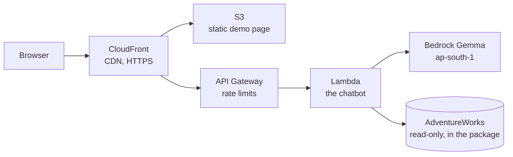
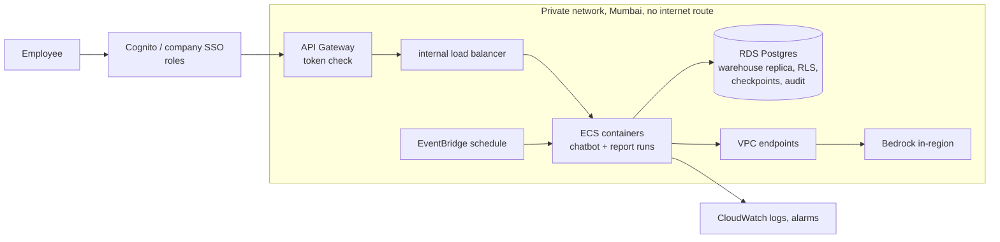

# 10. Deployment

## Two deployments for two jobs

| | Public demo | Enterprise deployment |
|---|---|---|
| Who uses it | anyone with the link (a recruiter, an interviewer) | signed-in employees, by role |
| Data | public AdventureWorks only | company warehouse |
| Shape | static web page + small serverless API | private network, containers, managed database |
| Running time | always on | deployed, evidenced, torn down (for this build) |
| Cost when idle | close to zero | a real daily cost |
| Status | **designed, next** | **designed**; Kubernetes manifests and Docker image built |

Why two: a private, login-protected system cannot be opened by someone you send a link to.
And keeping the full private stack running all month costs money for no one.

## What runs today

* **On a laptop**: `make demo` (a report, pauses at the gate), `make demo-chat Q="..."` (a
  question). All offline with the fake model, or on Bedrock with `--provider bedrock-converse`.
* **Docker**: CI builds the image and runs a full report in it with the fake model.
* **Kubernetes**: manifests for a scheduled report (a **CronJob** that runs to the human gate),
  an approver pod, and storage for checkpoints. They render in CI and were verified on a local
  kind cluster. A CronJob is Kubernetes' timetable: "run this container at 6am on the 1st".

## The public demo (designed)

* **S3 + CloudFront** serve the page. Serverless parts cost nothing when nobody uses them.
* **API Gateway** limits requests per second per visitor.
* **Lambda** runs the same `chat.ask()` as the laptop.
* **Controls**: a daily cap on questions; a cost kill switch (when the day's budget is hit, the
  API stops answering: fail closed); short answers; a banner saying "demo on public sample data";
  saved example answers that still show when live answers are paused.
* **Budget alarm**: AWS Budgets e-mails when spending on the `project=agentic` tag passes a
  limit.

## The enterprise deployment (designed)

Each piece, and why:

| Piece | Why |
|---|---|
| Private network (VPC) with no internet route | data and model calls never cross the public internet |
| VPC endpoints for Bedrock, logs, secrets | AWS services reached privately |
| Company single sign-on, roles as groups | who you are decides what you may ask and approve |
| Postgres with row-level security | the database itself filters rows by the user's region |
| Postgres for checkpoints and audit | any container can resume any run; audit in one place |
| EventBridge schedule | the monthly report runs on time, then waits for approval |
| Secrets Manager | database passwords never in code or environment files |
| CloudWatch alarms, SLOs, runbooks | someone is told when it breaks, and knows what to do |
| Terraform | the whole stack is code: reviewed, repeatable, and destroyable |

**SLO** (service level objective): a target such as "95% of answers in under 5 seconds".
**Runbook**: the written steps for a known problem, so whoever is on call can fix it.

## Decision: deploy, record evidence, destroy

For a reference build, the enterprise stack is created with Terraform, exercised, recorded
(screenshots, logs, the evidence of each control working), and destroyed the same day. That
proves it works without paying for idle servers. In a company it would simply stay up.

## Decision: dev and prod differ only by settings

The same Terraform code builds every environment. Only a variables file changes (sizes, names,
which account). If dev and prod are built differently, a test in dev proves nothing about prod.

Next: [11. Rebuild it in your enterprise](11-rebuild-in-your-enterprise.md)
