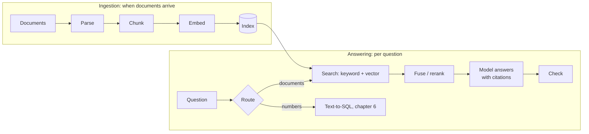

# 12. RAG: the architecture decisions

**RAG** (retrieval-augmented generation) means: find the passages of your documents that are
relevant to a question, give only those to a model, and have it answer from them, with
citations. It is how a model answers from documents it was never trained on.

Building a demo takes an afternoon. Building one that is right, cheap and fast for a million
users takes a series of decisions. This chapter is those decisions, each with a rule for
choosing. Chapter 13 applies them to this project.

> **Status.** This chapter is a decision framework. RAG in this repo is **designed, not
> built yet**; chapter 13 says what will be built and how it will be measured.

## The pipeline, so the words make sense

* **Chunk**: a piece of a document, from a sentence or two up to a page.
* **Embedding**: a list of numbers (a vector) that represents a chunk's meaning. Similar
  meanings give nearby vectors.
* **Vector search**: find chunks whose vectors are nearest the question's vector.
* **Keyword search (BM25)**: the classic search-engine score, based on shared words.

## Decision 0. Do you need RAG at all?

Ask this first. Two cases where the answer is no:

* **The answer is a number in a table.** "Sales of Mountain-200 in 2013" is a SQL question.
  Retrieving text about sales and asking a model to read a number from it is slower, costlier
  and less exact. Use text-to-SQL (chapter 6).
* **All the documents fit in the prompt.** See decision 5.

RAG is for knowledge that lives in text: policies, manuals, contracts, product descriptions,
research, past reports. Many real questions need both: "Why did reseller sales fall in Q3?"
wants the number from SQL and the explanation from a report. Plan for both from the start.

## Decision 1. Keyword, vector, or both, and do you rerank?

**The simple way.** Vector search only.

**What goes wrong.** Vectors are good at meaning ("bike for rough trails" finds "mountain
bike"). They are bad at exact strings: product codes, IDs, names with numbers. "Mountain-200"
and "Mountain-300" have almost the same vector. Keyword search gets these exactly right, and
misses paraphrases. Each covers the other's blind spot.

**What to do.** **Hybrid search**: run both, then combine the two ranked lists.

* **Reciprocal rank fusion (RRF)** is the standard way to combine them. Each chunk scores
  `1 / (60 + its rank)` in each list, summed. No model, no cost, no tuning of score scales,
  and deterministic. Start here.
* A **reranker** (a cross-encoder, such as Cohere Rerank or Amazon Rerank) reads the question and
  each candidate chunk together and re-scores them. It is more precise than either search
  alone, and it costs a model call per question and adds latency (often a few hundred
  milliseconds).

**How to decide on a reranker.** Measure. Build a golden set of questions with the chunks that
should be found. Compare **recall@5** (is the right chunk in the top 5?) with RRF alone and with a
reranker. Add the reranker only if the gain is worth its cost and delay at your volume.

**A regional catch, checked for this build.** In AWS Mumbai (16 Nov 2026), Bedrock serves no
reranking model. Using Cohere Rerank on Bedrock would send passages to another region. Options:
RRF only; host an open reranker model yourself in-region; or ask the in-region LLM to rerank
(costlier per question). Data residency can decide this before accuracy does.

## Decision 2. Route each question before answering it

Not every question needs the same, expensive path. A **router** sends each question down the
cheapest path that can answer it:

| Question type | Example | Path | Relative cost |
|---|---|---|---|
| Simple factual, repeated | "What is the return window?" | cache, or a short lookup | lowest |
| Statistical | "Internet sales in Canada last month" | text-to-SQL | low |
| Complex, joins tables | "Top 5 products by margin in Europe in Q3" | text-to-SQL with joins | medium |
| Document knowledge | "What does the Mountain-200 frame warranty cover?" | RAG | medium |
| Both | "Why did reseller sales fall in Q3?" | SQL + RAG, then combine | highest |
| Out of scope | "What's the weather?" | polite refusal | ~zero |

At a million users a day, routing is where most of the saving is: most questions repeat, and
most are simpler than the most expensive path.

**How to build the router, cheapest first:**

1. **Rules in code.** This repo's chatbot already routes this way: if the linker finds a
   governed metric, it is a SQL question; unknown words stop it. Rules are free, instant and
   explainable. Start here and measure how often they are unsure.
2. **A small trained classifier** for what rules cannot settle. The cheapest strong option is
   not a language model: embed the question (fractions of a cent per thousand questions) and
   train a simple classifier (logistic regression) on a few hundred labelled examples. It runs
   in milliseconds.
3. **A small language model (SLM)** as the classifier, such as a 4B-parameter model, when the
   categories need reasoning. Slower and costlier than step 2, still far cheaper than the big
   model.

**Mind the cost of a wrong route.** A statistical question sent to RAG gets a number read from
text, possibly stale. Give the router a "not sure" output that takes the safe path (or asks),
and track routing accuracy on a golden set like any other model.

## Decision 3. Text only, or text with numbers, codes and entities? (Do you need a graph?)

| Your documents | Example | Graph needed? |
|---|---|---|
| Text only, general topics | HR policies, FAQs, manuals | **No.** Hybrid search is enough. |
| Text full of names, codes, numbers that link to your data | product sheets, contracts naming SKUs, market reports naming regions | **Yes**, for entity resolution |
| Questions that hop across documents | "Which suppliers of parts used in recalled models are in Germany?" | **Yes**, to follow relationships |

**Entity resolution** means recognising that "MTB-200", "Mountain-200" and product key 358 are
the same thing. A **knowledge graph** stores those things and their links (product → subcategory
→ category; state → territory). With it, a question naming a product retrieves the chunks
about that product and its parents, and new tables or markets slot in as new nodes.

**Two ways to build the graph, very different in cost:**

* **From your structured data** (what this repo does): products, territories and their
  hierarchy come from the warehouse's own keys. Exact, cheap, refreshed with each data load.
* **Extracted from text by an LLM** (often called GraphRAG): a model reads every chunk and pulls
  out entities and relations. Powerful for text-only corpora, but it costs a model call per
  chunk at ingestion and the graph is only as good as the extraction. Use it when the
  relationships exist only in the text.

## Decision 4. Where to store the vectors

| Store | Good for | Watch out for |
|---|---|---|
| **In memory / a file** (numpy, SQLite) | up to tens of thousands of chunks; tests; demos | not shared between servers |
| **Postgres + pgvector** | up to millions of chunks; when you already run Postgres | tuning at very large scale |
| **Amazon S3 Vectors** | very large, rarely queried collections at low storage cost | roughly 100 ms for frequent queries, under a second for infrequent ones (AWS, GA Dec 2025); fewer search features |
| **OpenSearch** | keyword and vector search in one managed service | a minimum always-on capacity cost even when idle |
| **A dedicated vector database** (Qdrant, Milvus, Weaviate) | hundreds of millions of vectors; heavy filtered search; tight latency | one more system to run, secure, back up and pay for |

**How to decide**, in order:

1. **How many chunks, now and in two years?** Thousands: anything works; pick the simplest.
   Millions: Postgres is still fine. Hundreds of millions with low latency: a dedicated store.
2. **What do you already operate?** Every new system needs patching, backups, monitoring,
   access control and someone on call. Reusing Postgres often beats a faster engine.
3. **Do permissions live next to the data?** In Postgres, the same row-level security that
   protects tables can protect chunks: a user's search never sees a document they may not
   read. In a separate store you must copy the permissions and keep them in sync.
4. **How often is it queried?** Huge archive, rare queries: S3 Vectors. Busy chatbot: an
   in-memory index (Postgres with an HNSW index, or a vector database).

**HNSW** is the usual index for fast approximate nearest-neighbour search; most stores offer it.

## Decision 5. What kind of application? The corpus decides the architecture

| Situation | Architecture |
|---|---|
| Small, stable corpus (a call-centre FAQ of a few hundred pages) | Consider **no retrieval**: put it all in the prompt of a long-context model, with prompt caching if offered. Simplest, nothing to index. Check cost: every question pays for the whole corpus in tokens. |
| Medium corpus, changes weekly | Classic RAG, re-index on change. |
| Hundreds of PDFs every night | An **ingestion pipeline** is the main product (below). |
| Documents with different readers (HR, legal, sales) | Permission-aware retrieval from day one. |

**The long-context arithmetic.** At Gemma 3 12B's Mumbai price ($0.11 per million input tokens),
a 100,000-token corpus in every prompt costs about $0.011 per question in input alone, around 45
times our measured $0.00024 per SQL answer. At a million questions a day that is about $11,000
a day, against a few hundred for retrieval. Long models also attend less reliably to facts buried
in the middle of a very long prompt. Long context is a fine choice for small corpora and low
volume; retrieval wins as either grows.

**When hundreds of PDFs arrive every night**, the ingestion pipeline needs:

1. **Landing**: files arrive in a bucket; each gets an ID and a content hash. Same hash, skip it.
2. **Parse**: layout-aware, so tables, headings and lists survive; OCR for scans (for example
   Amazon Textract). Bad parsing is the most common cause of bad answers.
3. **Clean and scan**: remove boilerplate; find and mask personal data before indexing.
4. **Chunk** along the document's structure (sections, paragraphs), not every N characters.
5. **Metadata** per chunk: source, date, owner, version, and who may read it.
6. **Embed in batches**, recording which embedding model and version made each vector.
7. **Index**: insert new chunks, replace changed ones, delete removed ones. Build a new index
   version and switch to it when it is checked (blue/green), so a bad night does not break the bot.
8. **Check**: run the retrieval golden set on the new index before switching.
9. **Monitor**: files failed to parse, chunks per document, cost, time.

Every step must be safe to re-run (**idempotent**): a crash at 2am and a re-run must not
duplicate chunks.

## Decision 6. Balancing cost, quality and latency

Every option above moves one of three dials. A useful order of operations:

1. **Set targets first**: for example "answer quality at least X on the golden set, 95% of
   answers in under 3 seconds, under $0.001 per answer". Without targets, every debate is taste.
2. **Spend on retrieval before spending on the model.** A better top-5 usually helps more than a
   bigger model reading the wrong chunks.
3. **Cache.** Exact-match cache for repeated questions; a **semantic cache** (match by meaning)
   for near-repeats, with care: "sales in 2012" and "sales in 2013" are similar in meaning and
   different in answer.
4. **Route** (decision 2) so the expensive path is the exception.
5. **Send fewer, better tokens**: fewer chunks after reranking, short answers, no repeated
   instructions.
6. **Measure every change** on the golden set: quality, p95 latency, cost per answer.

## Decisions that are easy to forget

* **Chunk size.** Too small loses context; too large dilutes the match and costs tokens. A good
  default is a paragraph or a section, with its document title and heading attached to the chunk
  text so it stands alone.
* **Embedding model lock-in.** Vectors from different models cannot be compared. Changing model
  means re-embedding everything. Record the model ID with every vector, and choose by a
  retrieval benchmark, in-region, at your price.
* **Permissions before ranking.** Filter to the chunks this user may read, then rank. Filtering
  after ranking can leak titles or snippets, and can leave a user with no results.
* **Answer only from what was found, and say when nothing was.** If the best match is weak, reply
  "I could not find this in the documents" rather than letting the model fill the gap.
* **Citations that are checked.** Each claim cites a chunk ID; code checks that the cited chunks
  were really retrieved, and that every number in the answer appears in a cited chunk or a SQL
  result. That is chapter 5's checker, extended to documents.
* **Indirect prompt injection.** A document can contain "ignore your instructions...". Treat
  retrieved text as data: the model has no tools, the answer is checked, and ingestion can flag
  instruction-like text. (OWASP LLM01 and LLM08, chapter 9.)
* **Freshness and deletion.** Laws such as India's DPDP Act give people the right to have their
  data erased; a deleted document must leave the index too, and old answers that cited it should
  be traceable.
* **Agentic RAG, multi-step search.** Letting the model search, read, and search again answers
  multi-hop questions, at several times the cost and latency. Use it for the questions that need
  it (the router decides), not for every question.
* **Evaluate retrieval and answers separately.** Retrieval: recall@k, MRR. Answers: faithfulness
  (does every claim come from the cited text?) and correctness. If an answer is wrong, you then
  know which half to fix. A model can act as a judge for faithfulness, as one signal, never as
  the gate for numbers.
* **Log what was retrieved.** Store chunk IDs with every answer in the audit log, so a wrong
  answer can be traced to a bad chunk, a bad search, or a bad model.

Next: [13. RAG in this build](13-rag-in-this-build.md)
